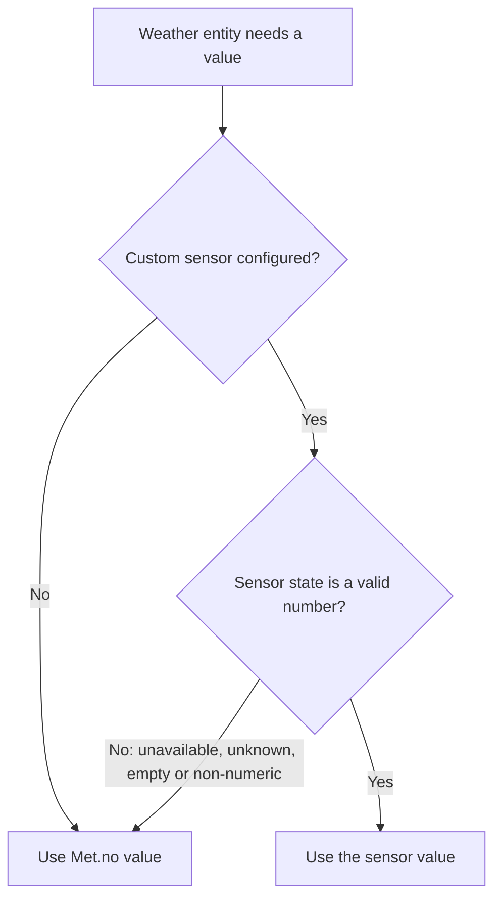

# Met.no for Home Assistant – resilient fork with custom sensor overrides

A modified version of the Home Assistant core **Meteorologisk institutt (Met.no)** integration (`met`) with two main improvements:

1. **Resilience to outages** – the weather entity no longer turns `unavailable` when the Met.no API is unreachable or your internet connection drops. The last known data keeps being served, and the integration retries every 5 minutes.
2. **Custom sensors for current conditions** – replace the *current* temperature, humidity and pressure reported by Met.no with values from your own local sensors (weather station, Zigbee sensor, etc.).

> This integration uses the same domain (`met`) as the built-in one. When installed as a custom component it **overrides** the core integration. Home Assistant will log a warning about this; that is expected.

---

## Table of contents

- [Features](#features)
- [Installation](#installation)
- [Configuration](#configuration)
- [Using your own temperature / humidity / pressure sensors](#using-your-own-temperature--humidity--pressure-sensors)
- [Outage handling](#outage-handling)
- [Tuning](#tuning)
- [Troubleshooting](#troubleshooting)
- [Technical details](#technical-details)
- [Credits and license](#credits-and-license)

---

## Features

- Current conditions and **daily + hourly forecasts** from the Met.no Locationforecast API (`complete` endpoint).
- Track the Home Assistant home location **or** configure a fixed location (latitude, longitude, elevation).
- Optional override of current **temperature**, **humidity** and **pressure** with any `sensor.*` entity.
- Automatic fallback to Met.no values when a custom sensor is unavailable.
- The entity stays available during temporary outages (up to 12 hours by default).
- Fast retry (5 minutes) after a failed update instead of waiting for the next hourly poll.
- Diagnostics support (coordinates are redacted).

---

## Installation

### Manual

1. Copy the `met` folder into your Home Assistant configuration directory:

   ```
   config/
   └── custom_components/
       └── met/
           ├── __init__.py
           ├── config_flow.py
           ├── const.py
           ├── coordinator.py
           ├── diagnostics.py
           ├── manifest.json
           ├── strings.json
           └── weather.py
   ```

2. Restart Home Assistant.
3. Go to **Settings → Devices & services**. If you already had Met.no configured, it keeps working with the new code. Otherwise click **Add integration** and search for *Meteorologisk institutt (Met.no)*.

### HACS (custom repository)

1. In HACS, open the three-dot menu → **Custom repositories**.
2. Add this repository URL, category **Integration**.
3. Install, then restart Home Assistant.

> The repository must contain `custom_components/met/` at its root, plus a `hacs.json` file.

---

## Configuration

Everything is configured from the UI.

| Field | Required | Description |
|---|---|---|
| Name | yes | Name of the weather entity. |
| Latitude / Longitude | yes | Location of the forecast. |
| Elevation | yes | Elevation in meters (improves temperature accuracy). |
| Custom temperature sensor | no | See [below](#using-your-own-temperature--humidity--pressure-sensors). |
| Custom humidity sensor | no | See below. |
| Custom pressure sensor | no | See below. |

You can change these later via **Settings → Devices & services → Met.no → Configure**. The entry reloads automatically when you save.

> **Note about the "Home" entry:** if your entry tracks the Home Assistant home location, saving the options form stores the coordinates explicitly. After that, the entry follows the coordinates you saved instead of tracking later changes of the home location. If you only want to add sensors and keep home tracking, double-check the coordinates shown in the form.

---

## Using your own temperature / humidity / pressure sensors

Met.no provides *modelled* values for your coordinates. If you own a local sensor, its reading is usually more accurate for **right now**. This integration lets you plug in up to three sensors, one per measurement.

### How to set it up

1. Open **Settings → Devices & services → Met.no → Configure**.
2. In the fields **Custom temperature sensor**, **Custom humidity sensor** and **Custom pressure sensor**, pick any entity from the `sensor` domain. All three fields are optional and independent: you can override only one of them.
3. Click **Submit**. The integration reloads and the weather entity immediately uses your sensors.

To go back to Met.no values, simply clear the field and submit again.

### How it works

For each of the three measurements the weather entity picks its value as follows:



Key behaviors:

- **Only the current conditions are replaced.** Daily and hourly **forecasts always come from Met.no** and are not modified.
- **Instant updates.** The integration subscribes to state changes of your sensors. Whenever one of them changes, the weather entity state is rewritten right away – there is no need to wait for the hourly Met.no refresh.
- **Automatic fallback.** If a sensor is `unavailable`, `unknown`, empty, or its state cannot be converted to a number, the entity silently falls back to the Met.no value for that measurement. It switches back to your sensor as soon as it reports a valid number again.
- **Independent per measurement.** A failing humidity sensor does not affect the temperature or pressure overrides.
- **Works during outages too.** Because the overrides are local, they keep updating even if Met.no is unreachable (as long as cached Met.no data is still within its maximum age, see [Outage handling](#outage-handling)).

### Units – important

The value of your sensor is used **as-is, without any unit conversion**. The integration expects the same native units as Met.no:

| Measurement | Expected unit of your sensor |
|---|---|
| Temperature | **°C** |
| Humidity | **%** |
| Pressure | **hPa** (equivalent to mbar) |

Home Assistant then converts the weather entity's values to the unit system you selected in your profile / general settings, as usual.

If your sensor uses another unit (°F, kPa, Pa, inHg…), create a **template sensor** that converts it first and select the template sensor in the integration. Example for a pressure sensor in kPa:

```yaml
template:
  - sensor:
      - name: "Outdoor pressure hPa"
        unit_of_measurement: "hPa"
        device_class: pressure
        state_class: measurement
        state: "{{ (states('sensor.outdoor_pressure_kpa') | float(0) * 10) | round(1) }}"
        availability: "{{ states('sensor.outdoor_pressure_kpa') | is_number }}"
```

> The `availability` template matters: when the source is unavailable, the template sensor becomes unavailable too, and the integration cleanly falls back to Met.no instead of showing `0`.

### Tips

- **Pressure:** use *sea-level* (relative) pressure if you want it comparable with weather services. A raw station (absolute) pressure sensor will read lower, depending on your elevation.
- **Use outdoor sensors.** An indoor sensor would give wrong "current weather" values.
- **Smoothing:** if your sensor is noisy, filter it first (e.g. with the `filter` or `statistics` integrations or a template) and select the filtered entity.

---

## Outage handling

The original integration marks the entity `unavailable` as soon as a single update fails, and then waits for the next poll (about one hour). This version behaves differently:

| Situation | Behavior |
|---|---|
| Update succeeds | Data is refreshed, normal interval (55–65 min, randomized) is restored. |
| Update fails (timeout, HTTP error ≥ 400, DNS/connection error, invalid JSON) | The last successful data is **kept**. The entity stays **available**. A retry is scheduled in **5 minutes**. Errors are still written to the log. |
| Failures continue for more than **12 hours** | The entity becomes `unavailable`, so you never display forecasts that are too old without noticing. |
| First setup while offline | Home Assistant reports the entry as *not ready* and retries automatically (standard behavior). |

When the connection comes back, the next retry succeeds and everything returns to normal – no restart needed.

---

## Tuning

Two constants at the top of `coordinator.py` control the outage behavior:

```python
# Retry interval after a failed update
RETRY_INTERVAL = timedelta(minutes=5)

# Maximum age of cached data before the entity becomes unavailable
MAX_DATA_AGE = timedelta(hours=12)
```

Met.no forecasts cover several days, so a longer `MAX_DATA_AGE` is usually safe. Do not set `RETRY_INTERVAL` too low: please respect the [Met.no terms of service](https://api.met.no/doc/TermsOfService) and avoid hammering the API.

---

## Troubleshooting

**The entity is unavailable**

- Check **Settings → System → Logs** for lines containing `met` or `metno`, such as:
  - `Access to ... returned error 'TimeoutError'`
  - `... returned 4xx/5xx`
- If the outage lasts more than `MAX_DATA_AGE`, the entity is intentionally unavailable. Restore connectivity and it recovers within `RETRY_INTERVAL`.

**My custom sensor is ignored**

- Make sure the sensor state is a plain number (no unit text, not `unavailable`/`unknown`).
- Check the sensor unit (see [Units](#units--important)).
- Re-open the options and confirm the entity is selected, then submit again.

**Enable debug logs**

```yaml
logger:
  default: warning
  logs:
    custom_components.met: debug
    metno: debug
```

**Diagnostics**

Download diagnostics from the integration page. They contain the current data and forecasts (latitude/longitude are redacted).

---

## Technical details

- **Class:** `iot_class: cloud_polling`, `integration_type: service`.
- **Library:** [`PyMetno==0.13.0`](https://pypi.org/project/PyMetno/).
- **API endpoint:** the dedicated Home Assistant Met.no endpoint (`api.met.no/weatherapi/locationforecast/2.0/complete`). Do not change it.
- **Polling interval:** 55–65 minutes (random, to spread the load on Met.no), 5 minutes after a failure.
- **Forecasts:** daily (5 days) and hourly (next 48 hours).
- **Availability logic:** `MetWeather.available` returns `True` while the coordinator holds data younger than `MAX_DATA_AGE`.
- **Custom sensors:** read from `hass.states` at render time and tracked with `async_track_state_change_event`. Applied to `native_temperature`, `humidity` and `native_pressure` only.

### Files changed compared with the core integration

| File | Change |
|---|---|
| `coordinator.py` | Fast retry after failure, `last_success_time`, `has_fresh_enough_data`, `RETRY_INTERVAL`, `MAX_DATA_AGE`. |
| `weather.py` | `available` property based on cached data age; custom temperature / humidity / pressure sensor overrides with state tracking. |
| `config_flow.py` / `strings.json` / `const.py` | Optional entity selectors for the three custom sensors. |

---

## Credits and license

- Based on the Home Assistant core [`met`](https://www.home-assistant.io/integrations/met) integration (Apache License 2.0).
- Weather data from the [Norwegian Meteorological Institute (MET Norway)](https://www.met.no/en), provided under their open data license. Attribution is displayed on the weather entity.
- This project is not affiliated with Home Assistant, Nabu Casa or MET Norway.
